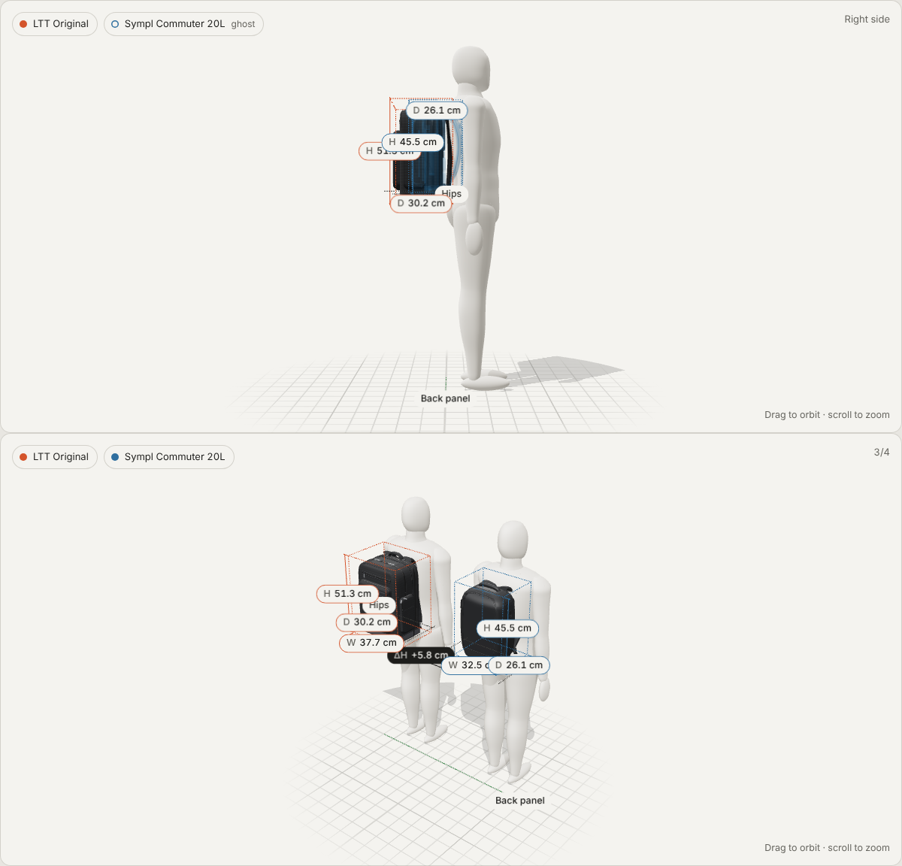

# Backpack Size Lab

Compare backpacks in 3D at real scale. Pick any two bags and see them overlaid or side by side, with dotted measuring boxes, preset camera angles, a full spec comparison, and a person model whose height and weight you can adjust to see how each bag sits on your back.

**Live site:** https://nadavm-eng.github.io/backpack-size-lab/


## Features

- **Seven bags, modelled from real photos:** LTT Original, Sympl Commuter 20L / 24L, Aer City Pack Pro 2 20L / 24L, Aer Travel Pack 4 28L and the JanSport SuperBreak.
- **Overlay or side by side**, with one bag see-through ("ghost") in overlay mode.
- **Aligned at the back panel:** every bag starts at the same line where it meets your back, so you can see which one sticks out further.
- **Measuring boxes** with height, width and depth in cm, and a height-difference line in side-by-side mode.
- **Free 360° orbit** plus Front, Back, Left, Right, Top and 3/4 presets (keys 1–6).
- **Person mode:** a mannequin with height (150–200 cm) and weight (45–130 kg) sliders. Each bag is placed on the upper back and the page reports where it ends relative to the hips, flagging bags that are too long for that torso.
- **Specs:** a "What's different" summary (volume, weight, size, laptop, price) and a full spec table with source links.
- **Add your bag:** compare any backpack. The visitor copies "Instructions for your AI" into any assistant, the assistant researches the bag and writes one `.bag.json` file, and the visitor drops it on the page. It appears in both pickers under "Your bags (this browser only)", tagged as a real 3D model, a simple-shape model or a plain box, and works in every view, in person mode and in the spec table. Nothing is uploaded: added bags are kept in that browser (IndexedDB), and a red × removes one (with Undo).



## Project layout

```
docs/                 the website (served by GitHub Pages)
  index.html          single-page app (three.js from jsDelivr, no build step)
  bags.json           all bag data: shape parameters for the generator + specs for the site
  models/*.glb        the 3D models
  ai-instructions.md  "Instructions for your AI": how an assistant makes a bag file
  examples/           an example bag file (a made-up bag, shape recipe)
build_models.py       Blender generator: reads docs/bags.json, writes docs/models/<id>.glb
builders/             one builder per brand (class Builder(Bag)) + photo-matched render scripts
tools/                export_bag_file.py (pack a bag into one bag file), check_model.py (same-plane
                      overlaps, colour from a photo), render_bag.py (render any bag from any angle),
                      compare_sheet.py (photos next to renders)
references/*/         measurements taken from reference photos, with sources
media/                screenshots for this README
requirements.txt      bpy 5.2.3, numpy, pillow, scipy
```

## Run the site locally

It's a static page, so any local web server works:

```bash
cd docs
python3 -m http.server 8000
# open http://localhost:8000
```

## Rebuild the 3D models

The models are generated headlessly with Blender's Python module.

```bash
python3 -m pip install -r requirements.txt     # bpy 5.2.3 (Blender as a Python module) needs Python 3.13
python3 build_models.py                        # all bags
python3 build_models.py --only sympl-commuter-20   # one bag
```

Each run prints the measured bounding box, checks size, triangle count and file size, and lists any
same-plane overlaps (surfaces of different materials in one plane, which flicker on the site as the camera
turns; `python3 tools/check_model.py docs/models/<id>.glb` checks a finished file). Preview renders:

```bash
python3 builders/sympl_render.py sympl-commuter-20             # the views of the Sympl reference photos
python3 tools/render_bag.py sympl-commuter-20 --view p07:-35:12:60   # any bag, any angle (name:azimuth:elevation:lens)
python3 tools/compare_sheet.py --blend --out work/compare/round1.png photo.jpg work/renders/<id>/<id>_front.png front
```

## Add a bag

1. Add an entry to `docs/bags.json` with an `id`, `name`, `brand`, `accent` colour, a `shape` block and a `specs` block (copy an existing bag as a template). The site picks it up automatically.
2. Write the measurements from the reference photos to `references/<id>/MEASUREMENTS.md` first (see `references/sympl/`).
3. Optionally add `builders/<name>.py` with a `class Builder(Bag)` for brand-specific details, and set `"builder": "<name>"` on the bag. Without one, the generic builder is used.
4. Run `python3 build_models.py --only <id>`, render it with `tools/render_bag.py`, compare with the photos, repeat.
5. To hand the bag to someone else as one file instead: `python3 tools/export_bag_file.py <id>` (it reads `references/<id>/research.json` if there is one, otherwise the `bags.json` entry).

Model conventions: glTF Y-up in metres, origin at the bottom centre of the body, front +Z, back −Z, width along X. Name parts `<id>_<part>`; the body shell must be `<id>_body` and back padding `<id>_back_pad` (or `pads` / `back_mesh`), because the site uses those names to line bags up at the back panel.

## Bag files ("Add your bag")

A bag file, `<id>.bag.json`, is one JSON object in the format `backpack-size-lab/bag@1`
(`docs/ai-instructions.md` sections 8 to 12 describe every field):

- the facts the site shows (listed size with what it covers, volume, weight, laptop, compartments, pockets,
  material, opening, warranty, one price in the buyer's currency, more specs), each with its source link;
- how the model was made (`made_with`: route A, B or C, tools, photos used, comparison rounds, what is estimated);
- the model: either a **real mesh** (`model.glb_base64`, a self-contained GLB in the built-in bags' frame, plus
  `model.geom.back`, the nodes that make the back panel), or a **shape recipe** the page builds itself
  (body cross-sections lofted into a soft body, plus pockets, patches with text, zips, webbing, shoulder
  straps, a handle, a lid, boxes and tubes; see `docs/examples/acme-trail-22.bag.json`), or nothing
  (a rounded box at the listed size).

The page treats the file as untrusted: sizes, counts and ranges are capped (a mesh at most 12 MB and
400,000 triangles), meshes that name outside files are refused, text is only ever shown as text, links
must be http(s), and nothing the file names is fetched. It measures the model itself, lines it up at the
back panel like the built-in bags, and warns when it differs from the listed size by more than 1 cm.
Problems are reported in messages the visitor can paste back to their AI.

`tools/export_bag_file.py <id>` packs any bag built here (for example
`python3 tools/export_bag_file.py aer-cpp2-20` writes `work/export/aer-cpp2-20.bag.json`).

## Design

The site shares its design language with its sister project, Printers Size Lab: see
[DESIGN.md](https://github.com/NadavM-Eng/printers-size-lab/blob/main/DESIGN.md) there.

## How the models were made

Each bag was modelled from 12–33 real photos (manufacturer studio shots plus real-world review photos, mostly from [Nomads Nation](https://nomadsnation.com)). Measurements were taken from the straight front, side and back views, written to `references/<bag>/MEASUREMENTS.md`, and the renders were compared side by side with the photos over several rounds. The photos themselves are not included in this repository because they belong to their owners; the measurement files link to the sources.

The models are approximations: fabric is smoother than the real thing, and some small details are simplified.

## Notes

Brand names and logos (Aer, JanSport, LTT, Sympl) belong to their owners and appear only to identify the products being compared. This project is not affiliated with any of them. Specs and prices come from the linked retailer and review pages and may have changed.

## License

Code: [MIT](LICENSE).
