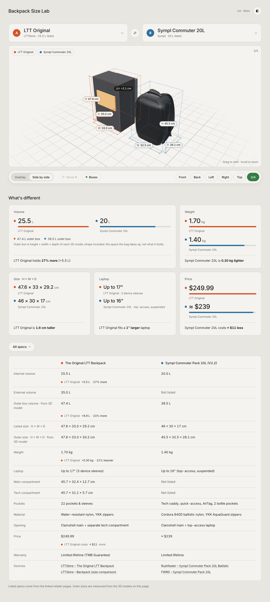

# Backpack Size Lab

Compare backpacks in 3D at real scale. Pick any two bags and see them overlaid or side by side, with dotted measuring boxes, preset camera angles, a full spec comparison, and a person model whose height and weight you can adjust to see how each bag sits on your back.

**Live site:** https://nadavm-eng.github.io/backpack-size-lab/



## Features

- **Seven bags, modelled from real photos:** LTT Original, Sympl Commuter 20L / 24L, Aer City Pack Pro 2 20L / 24L, Aer Travel Pack 4 28L and the JanSport SuperBreak.
- **Overlay or side by side**, with one bag see-through ("ghost") in overlay mode.
- **Aligned at the back panel:** every bag starts at the same line where it meets your back, so you can see which one sticks out further.
- **Measuring boxes** with height, width and depth in cm, and a height-difference line in side-by-side mode.
- **Free 360° orbit** plus Front, Back, Left, Right, Top and 3/4 presets (keys 1–6).
- **Person mode:** a mannequin with height (150–200 cm) and weight (45–130 kg) sliders. Each bag is placed on the upper back and the page reports where it ends relative to the hips, flagging bags that are too long for that torso.
- **Specs:** a "What's different" summary (volume, weight, size, laptop, price) and a full spec table with source links.


## Project layout

```
docs/                 the website (served by GitHub Pages)
  index.html          single-page app (three.js from jsDelivr, no build step)
  bags.json           all bag data: shape parameters for the generator + specs for the site
  models/*.glb        the 3D models
build_models.py       Blender generator: reads docs/bags.json, writes docs/models/<id>.glb
builders/             one builder per brand (class Builder(Bag)) + photo-matched render scripts
references/*/         measurements taken from reference photos, with sources
media/                screenshots for this README
```

## Run the site locally

It's a static page, so any local web server works:

```bash
cd docs
python3 -m http.server 8000
# open http://localhost:8000
```

## Rebuild the 3D models

The models are generated headlessly with Blender's Python module.

```bash
pip install bpy==5.2.3        # Blender as a Python module (needs a matching Python version)
python3 build_models.py                        # all bags
python3 build_models.py --only sympl-commuter-20   # one bag
```

Each run prints the measured bounding box and checks size, triangle count and file size. Photo-matched preview renders:

```bash
python3 builders/sympl_render.py sympl-commuter-20
```

## Add a bag

1. Add an entry to `docs/bags.json` with an `id`, `name`, `brand`, `accent` colour, a `shape` block and a `specs` block (copy an existing bag as a template). The site picks it up automatically.
2. Optionally add `builders/<name>.py` with a `class Builder(Bag)` for brand-specific details, and set `"builder": "<name>"` on the bag. Without one, the generic builder is used.
3. Run `python3 build_models.py --only <id>`.

Model conventions: glTF Y-up in metres, origin at the bottom centre of the body, front +Z, back −Z, width along X. Name parts `<id>_<part>`; the body shell must be `<id>_body` and back padding `<id>_back_pad` (or `pads` / `back_mesh`), because the site uses those names to line bags up at the back panel.

## How the models were made

Each bag was modelled from 12–33 real photos (manufacturer studio shots plus real-world review photos, mostly from [Nomads Nation](https://nomadsnation.com)). Measurements were taken from the straight front, side and back views, written to `references/<bag>/MEASUREMENTS.md`, and the renders were compared side by side with the photos over several rounds. The photos themselves are not included in this repository because they belong to their owners; the measurement files link to the sources.

The models are approximations: fabric is smoother than the real thing, and some small details are simplified.

## Notes

Brand names and logos (Aer, JanSport, LTT, Sympl) belong to their owners and appear only to identify the products being compared. This project is not affiliated with any of them. Specs and prices come from the linked retailer and review pages and may have changed.

## License

Code: [MIT](LICENSE).
